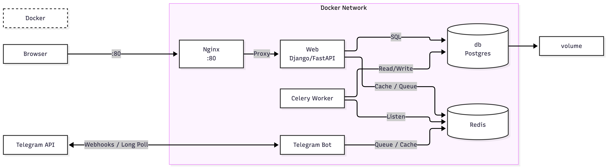

# Social Media API


[](https://github.com/ilybueface/SocialMediaApi/actions/workflows/deploy.yml)

REST API for a social media platform built with Django REST Framework.

Users can view and share posts, subscribe to each other, share stories and like posts

The API supports pagination, filtering, and sorting for all list endpoints


## Tech stack

- Python
- Django 6.x
- Django REST Framework
- Nginx
- GitHub Actions
- Aiogram 3.x
- PostgreSQL
- Docker + Docker compose
- Redis
- Celery
- pytest
- JWT (djangorestframework-simplejwt)


## How to run

### Prerequisites

* **Docker**
* **Docker compose**


### Running the Application

1. **Clone the repository:**

```bash
git clone https://github.com/ilybueface/SocialMediaApi
cd SocialMediaApi
```

2. **Configure the environment:**


Create a `.env` file in the root folder and add your keys there, following the example below:

```.env
POSTGRES_DB=social_media_db
POSTGRES_USER=postgres
POSTGRES_PASSWORD=postgres
POSTGRES_ENGINE=...
POSTGRES_PORT=...
SECRET_KEY=...
TELEGRAMM_KEY=(your telegram token)
TELEGRAMM_CHAT_ID=(your telegram id)
ALLOWED_HOSTS=.....
DEBUG=True or False(choose the mode yourself)
```

3. **Build and launch containers**

```bash
docker compose up --build -d
```


## Running tests

**Running in a container that is already up**

If the project is already running via `docker compose up`, execute the following command in a separate terminal tab:
```bash
docker compose exec web pytest
```

## Telegram Bot

An **asynchronous Telegram bot** built with the **Aiogram 3.x** framework is integrated into the project. Its primary purpose is to simplify DevOps routines by providing basic infrastructure monitoring tools directly within the messenger.

### Key Features:
* **Container Monitoring:** Using the `/status` command, the bot checks the Docker environment and displays the current state of the containers (e.g., `running` or `exited`).
* **Error Logging:** The bot automatically forwards logs with the **ERROR** severity level specifically caught during HTTP request processing (`django.request`). Manual errors logged outside the HTTP request lifecycle will not be sent to the chat.
* **Access Control (Custom Handler):** Access to the bot is strictly restricted. A custom authentication handler ensures that the bot only processes commands sent by the specific owner (validated against `TELEGRAMM_CHAT_ID`).

### Important Technical Considerations:
* The `/status` command displays **only** the container statuses within Docker. There is no web-level application check (HTTP health check).
* Mounting the Docker socket in read-only mode (`:ro`) restricts file system modifications but **does not** limit commands or requests sent to the Docker API.
* The system is designed strictly for basic `ERROR` log forwarding and container status viewing. It does not implement complex third-party infrastructure health monitoring or advanced secure access protocols.


## CI/CD & Deployment (GitHub Actions)

The project includes a complete Continuous Integration and Continuous Delivery (CI/CD) pipeline powered by **GitHub Actions**. This ensures code reliability and automates server updates.

### Workflow Breakdown:
* **CI Testing:** Every push or pull request automatically triggers the test pipeline. It sets up an isolated environment, configures the database, installs dependencies, and runs the entire test suite using `pytest`.
* **CD Deployment:** Once all tests pass successfully, GitHub Actions automatically deploys the latest changes to the remote production server, eliminating manual steps.
* **Environment Separation:** 
  * `docker-compose.yml` is optimized for local development and testing.
  * `docker-compose.prod.yml` is used for the production server. It is tailored for live deployment, running containers in the background (`-d`), managing the **Nginx** web server, and orchestrating production-ready service communication.

## Celery + Redis

The project is configured for asynchronous notification delivery. Instead of overloading the web server's main thread, operations that don’t need to block the response have been offloaded to dedicated background processes.

### What is happening?
When a user publishes a post, **the web server immediately returns a success response** without waiting for the notification to be processed. The actual delivery (`send_user_notification`) is pushed to Redis as a background task. The user receives an instant confirmation that their post is published, while a separate Celery worker process handles the simulated notification delivery by logging the message to the console in the background.

### Why is it designed this way?
* **Instant Response (UI/UX):** Outbound network requests introduce unpredictable latency. Moving this logic out of the request-response cycle ensures the user never experiences frozen screens.
* **Production-Ready Retry Strategy:** Currently, the task simulates the delivery by logging it to the console. However, the error-handling configuration-including `autoretry_for=(ConnectionError, Timeout)`, a limit of 20 retries, and an exponential backoff capped at 30 seconds-is intentionally pre-configured for a future production upgrade to a real HTTP request (e.g., integration with an external SMS or Email gateway).
* **Database State Safety:** Tasks are dispatched strictly using `transaction.on_commit`. This guarantees that the notification message is sent to the broker only *after* the Django database transaction is successfully committed. Without this, a fast Celery worker could try to fetch a post that does not yet exist in the database.
* **Production-Ready Security:** For security reasons, the Celery worker process runs as a non-root user within the container environment to mitigate privilege escalation risks.

### What role does Redis play?
**Redis acts as the message broker (the task queue).**
* Django does not execute the `send_user_notification` function code directly. Instead, it serializes the function arguments into a lightweight message and drops it into Redis.
* The message remains stored safely inside Redis until an available **Celery worker process** fetches it. 
* *Note on reliability:* Under default Celery settings, tasks are acknowledged immediately upon receipt. This setup specifically protects against web server (Django) crashes while tasks are waiting in the queue, but does not guarantee delivery if the Celery worker process itself is abruptly terminated mid-execution.


## API Endpoints

| Method | Endpoint                     | Description                          |
|--------|------------------------------|--------------------------------------|
| POST   | /api/token/                  | Get JWT tokens                       |
| GET    | /backend/post/               | Get feed (posts from followed users) |
| POST   | /backend/post/               | Create post                          |
| POST   | /backend/post/{id}/like/     | Like a post                          |
| DELETE | /backend/post/{id}/unlike/   | Unlike a post                        |
| POST   | /backend/user/{id}/follow/   | Follow a user                        |
| DELETE | /backend/user/{id}/unfollow/ | Unfollow a user                      |
| GET    | /backend/post/{id}/comments/ | Get post comments                    |
| GET    | /backend/story/              | Active stories                       |


## 🚀 API Documentation & Testing

The complete and interactive API documentation is available via Swagger UI once the project is running:

🔗 **[http://localhost:80/api/docs/](http://localhost:80/api/docs/)**

### 🔒 Access & Permissions Note
* **Without an Authentication Token:** You can only browse the available endpoints, view the API schema, and perform user registration (`/backend/user/`).
* **For Protected Endpoints:** To test creation, modification, or deletion endpoints directly inside Swagger, you must first register/login, obtain a JWT/Token, and authorize yourself using the **"Authorize"** button at the top of the Swagger page.


## Architecture

